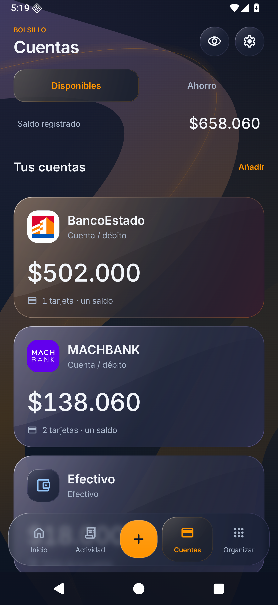
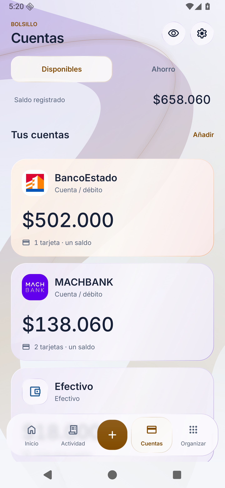

# Bolsillo

Una app Android nativa para llevar tus cuentas, gastos, ahorro y dinero por cobrar. Pensada para pesos chilenos y uso personal, con datos cifrados en el teléfono y una interfaz de vidrio adaptable a pantallas móviles.

**[Descargar la última versión](https://github.com/MatPR-26/Bolsillo/releases/latest)** · [Privacidad](PRIVACY.md) · [Cambios](CHANGELOG.md) · [Compilar y publicar](docs/MAINTAINER.md)

 
 

Capturas de la app con datos ficticios y una paleta personalizada.

## Lo esencial

| Tu dinero | Menos trabajo manual |
|---|---|
| Cuentas, ahorro, tarjetas y saldo disponible tras los previstos | Avisos de varias apps al mismo tiempo: banco, Wallet, Onepay y Gmail |
| Tu parte real de los gastos compartidos | Revisión individual o múltiple al mantener pulsado |
| Personas, préstamos, deudas anteriores y abonos con fecha/nota | Categoría rápida y clasificación de movimientos del mismo comercio |
| Suscripciones, presupuestos, metas e ingresos de trabajo | Registro rápido, widget y dictado con confirmación |
| Gráficos por categoría, período y cuenta | Tutorial opcional con foco visual y actualizaciones desde GitHub |

## Empezar

1. Instala el APK de Releases. Si ya usas una versión nativa anterior, instálalo encima: **no desinstales la app**, así conservarás el registro y la clave del teléfono.
2. Elige tus bancos. Solo se crean las plantillas seleccionadas; puedes añadir más desde **Cuentas → Añadir bancos**. No se conecta a un banco: ajusta el saldo inicial de tus cuentas.
3. Abre **Organizar → Dinero → Automatización**. El tutorial destaca qué configurar y se puede saltar o reabrir con **Activar tutorial**.
4. Selecciona todas las apps cuyos avisos quieras leer, concede a Bolsillo acceso a notificaciones y activa la detección. Las tarjetas físicas y digitales pueden compartir la misma cuenta.
5. En **Ajustes → Avisos de Bolsillo**, concede el permiso para recibir sus confirmaciones. Es independiente del permiso para leer avisos. Puedes enviar una notificación de prueba.

El catálogo incluye BancoEstado, MACHBANK, Banco de Chile, Santander, Bci, Scotiabank, Itaú, Banco Falabella, BICE, Consorcio, Internacional, Security, Ripley, Tenpo, Coopeuch y Mercado Pago. También puedes crear una cuenta personalizada. Las imágenes se incluyen localmente y solo identifican cada institución; Bolsillo no está afiliado a ellas.

En **Ajustes → Apariencia → Tus colores** puedes elegir el acento y los reflejos de la app. Se conservan las paletas Prisma, Océano y Ámbar, los modos claro, oscuro y sistema y los niveles de profundidad. Las tarjetas y servicios calculan sus propios degradados desde las imágenes de sus marcas y se adaptan al modo de luz.

## Compartir sin inflar tus gastos

En **Organizar → Planear → Suscripciones** encontrarás un catálogo de 60 servicios de vídeo, música, inteligencia artificial, juegos y otras categorías. Elige un servicio y configura tu plan, importe, fecha y cuenta; las plantillas no generan cobros por sí solas.

Si pagas Netflix por $9.990 y otra persona aporta $5.000, el gasto personal del mes es **$4.990**. La cuenta conserva el cargo completo de $9.990 y el cobro se registra aparte, con fecha y nota. Recibir un abono no vuelve a sumar un ingreso por la misma deuda. Si un pago llegó como ingreso normal, puedes vincularlo al cobro desde su movimiento.

## Detección y revisiones

Bolsillo procesa únicamente las apps elegidas. Reconoce patrones de compras y transferencias en CLP; los montos dudosos, cuentas ambiguas o posibles duplicados requieren revisión. Para una instalación nueva, los patrones necesitan confirmaciones antes de automatizarse. Gmail se utiliza mediante sus **notificaciones visibles**: no se accede al buzón completo.

Una plantilla bancaria no garantiza que todos sus formatos de notificación sean reconocidos. Si el banco no entrega un aviso legible, el movimiento puede faltar. Revisa el diagnóstico y compara periódicamente tus registros con tu saldo real. La app conserva el historial local de cambios y abonos.

## Actualizar

En **Ajustes → Actualizaciones** puedes comprobar manualmente o descargar una versión nueva. La app comprueba versiones al abrirla, como máximo una vez al día tras una consulta correcta; un punto naranja indica que existe una actualización. El APK se descarga solo cuando lo pides, se verifica y **Android te pide confirmar su instalación**. Se conserva el paquete y la firma para mantener tus registros.

El actualizador está disponible desde la versión 15. Para actualizar una versión anterior, descarga el APK de la última publicación e instálalo encima de la app existente.

## Desarrollo

Java nativo y Android Views; SDK mínimo 26, target 36. Sin WebView, servidor propio, publicidad ni analítica. El permiso de Internet se utiliza para consultar GitHub y descargar el APK solicitado. Los datos financieros no se envían allí.

Las guías para contribuir, compilar y publicar están en [docs/MAINTAINER.md](docs/MAINTAINER.md). La documentación técnica de navegación y animaciones está en [docs/RENDIMIENTO.md](docs/RENDIMIENTO.md).

Los recursos de terceros conservan sus licencias y atribuciones en [source/android/licenses](source/android/licenses). Las marcas de instituciones y servicios pertenecen a sus titulares y se usan para identificación. No se otorga una licencia general sobre esas marcas.
